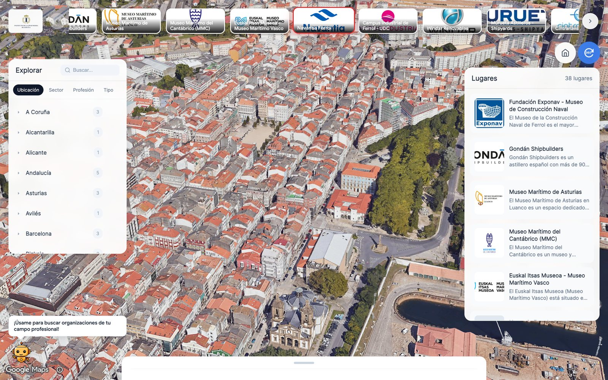
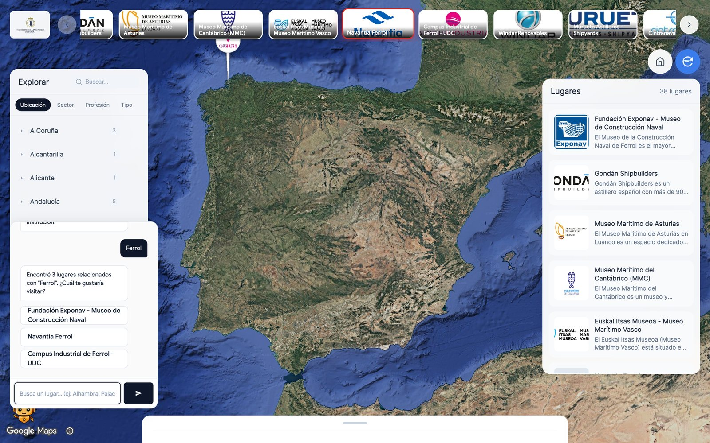
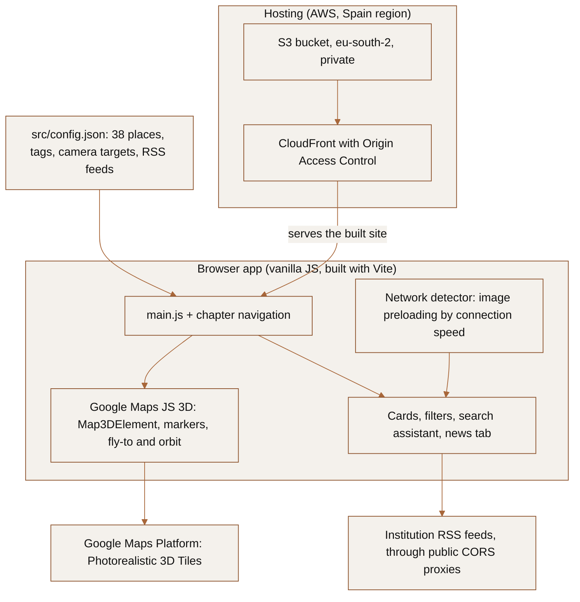

# Explorar España · Ingenet 3D

**An interactive 3D map of Spain's engineering network, built for the
Instituto de la Ingeniería de España (IIE).** Thirty-eight museums, shipyards,
universities and technology centres on Google's photorealistic 3D map, so a
student can fly to a shipyard in Ferrol or a naval museum in Cartagena and see
what engineers actually do there.

[](https://d6bj2oo3yl8y7.cloudfront.net)
[](LICENSE)
[](package.json)

[Live site](https://d6bj2oo3yl8y7.cloudfront.net) · [IIE project page](https://www.iies.es/ingenet) · [Handover guide](CONTRIBUTING.md)

> [!IMPORTANT]
> **Looking for a new owner.** I built and ran this as a volunteer for the
> IIE and can no longer support it. The site is live and works, but it runs
> on an AWS account and a Google Maps Platform key that are mine. Anyone
> taking it over needs to move both. [CONTRIBUTING.md](CONTRIBUTING.md)
> has the transition checklist, how to run and deploy it, how to edit the
> places, and the known issues. Open an issue or contact the IIE if you
> want to pick it up.



<details>
<summary><b>Resumen en español</b></summary>

Explorar España es un mapa 3D interactivo de la red INGENET del Instituto de
la Ingeniería de España: 38 museos, astilleros, universidades y centros
tecnológicos sobre el mapa fotorrealista de Google, pensado para acercar la
ingeniería a los jóvenes. Ganó el I Premio IIE–AWS al mejor proyecto con
tecnología de AWS (diciembre de 2025).

El proyecto busca un nuevo responsable. La web funciona, pero depende de una
cuenta de AWS y de una clave de Google Maps Platform a mi nombre. La guía de
traspaso está en [CONTRIBUTING.md](CONTRIBUTING.md): cómo ejecutarlo, cómo
desplegarlo, cómo añadir o editar lugares y qué hay que mover para cambiar de
responsable.

</details>

---

## What it does

- **38 places, one map.** Each place has a card with a description, period,
  address, website and logo, and the camera flies to it and orbits the
  building on Google's Photorealistic 3D Tiles.
- **Filters by location, sector, profession and type.** "Naval" and
  "Ferrol" are tags, not hard-coded categories, so the same data can be
  sliced by city, by industry or by the kind of engineer who works there.
- **A search assistant.** The robot in the corner answers queries like
  "Ferrol" or "astillero" with matching places. It is a local keyword search
  over the place data, not a language model, so it costs nothing to run.
- **News per place.** The "Novedades" tab reads an institution's RSS feed,
  configured per place or auto-detected from its website.
- **Adapts to the connection.** It measures the network at start-up, warns
  on slow links and preloads place images in smaller batches.

**Recognition.** First prize in the first IIE–AWS award for the best project
built on AWS, presented at the IIE in Madrid on 19 December 2025
([IIE announcement](https://www.iies.es/single-post/entrega-del-premio-iie-aws-al-mejor-proyecto-con-tecnología-de-aws)).

<table>
  <tr>
    <td width="50%"></td>
    <td width="50%"></td>
  </tr>
  <tr>
    <td><sub><b>Opening view.</b> Filters on the left, the 38 places on the right, the institutions along the top.</sub></td>
    <td><sub><b>Search.</b> "Ferrol" returns the three places there; picking one flies the camera to it.</sub></td>
  </tr>
</table>

---

## How it works



The whole application is static: `npm run build` produces a `dist/` folder
that `deploy/deploy.sh` uploads to S3 and serves through CloudFront. There is
no server and no database. Every place lives in `src/config.json`, so content
changes are edits to one JSON file followed by a deploy.

---

## Run it locally

```bash
npm install
cp .env.example .env          # add a Google Maps Platform key (see below)
npm run dev                   # http://localhost:3000
```

The key needs the **Maps JavaScript API** enabled. Restrict it to HTTP
referrers (your domain and `http://localhost:3000/*`) in Google Cloud Console:
the key is visible to every browser that loads the site, so the restriction
is what protects it.

`npm run build` writes the production site to `dist/`; `npm run preview`
serves it.

## Edit the places

Each entry in `src/config.json` → `chapters` is one place. The fields that
matter:

```jsonc
{
  "id": 1,
  "title": "Fundación Exponav - Museo de Construcción Naval",
  "placeName": "Museo Naval da Armada, ... Ferrol, A Coruña, Spain",  // what the camera searches for
  "cameraCoordinates": { "lat": 43.4824, "lng": -8.2316, "elevation": 10 },
  "cameraStyle": "drone-orbit",
  "content": "Description shown on the card",
  "dateTime": "1750-Presente",
  "address": "...", "website": "https://exponav.org/",
  "logoUrl": "assets/logos/<file>.jpg", "imageUrl": "...", "imageCredit": "...",
  "etiquetas": {                       // drives the four filters
    "ubicacion": ["Ferrol", "Galicia"], "sector": ["Naval"],
    "profesion": ["Ingeniero Naval"],  "tipo": ["Museo"]
  },
  "newsConfig": { "rssUrl": "https://exponav.org/feed", "keywords": ["exponav"] }  // optional
}
```

`scripts/download-logos.sh` and `scripts/update-config-logos.py` fetch logos
into `src/assets/logos/` and point the config at the local copies.
[CONTRIBUTING.md](CONTRIBUTING.md#editing-places) has the full field list.

## Deploy

```bash
./deploy/setup-infrastructure.sh   # once: S3 bucket in eu-south-2 + CloudFront with OAC
./deploy/deploy.sh                 # every release: build, upload, invalidate the cache
```

Both read an AWS CLI profile (default `ingenet3d`) and write or read
`production-config.sh`, which is gitignored. Details and the move to a new
AWS account are in [CONTRIBUTING.md](CONTRIBUTING.md#transition-checklist).

---

## Repository

```
src/
  index.html            page shell; loads the Maps JS API with the key from .env
  main.js               app start-up, UI wiring
  config.json           the 38 places: the only file content editors touch
  chapters/             navigation between places
  utils/                3D map, markers, search assistant, news, performance
  styles/, main.css     component styles
  assets/               logos, photos, fonts, IIE branding
deploy/                 infrastructure setup and release scripts
scripts/                logo download and config tooling
docs/history/           performance and migration notes from 2025 (historical)
```

## Origin and credits

This started as a fork of Google's
[3D Storytelling solution](https://github.com/googlemaps-samples/js-3d-storytelling)
(Apache-2.0), whose authors' history is kept in this repository. In 2025 I
rebuilt it for the IIE's INGENET network and in December 2025 replaced its
CesiumJS renderer with the Google Maps JavaScript 3D maps. Map imagery is
© Google. Institution names and logos belong to their owners. See
[NOTICE](NOTICE).

## Licence

Apache-2.0. See [LICENSE](LICENSE) and [NOTICE](NOTICE).
